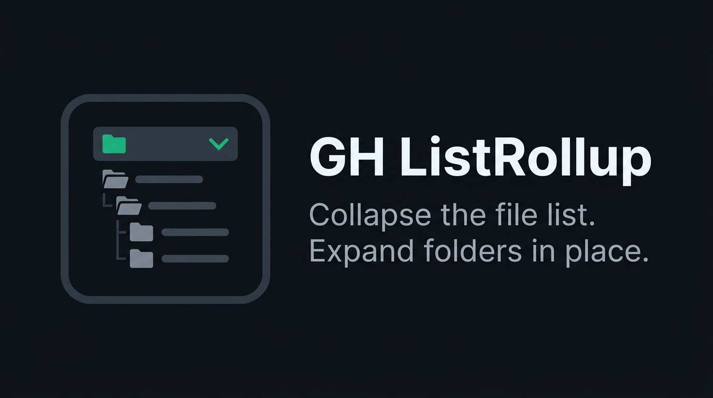
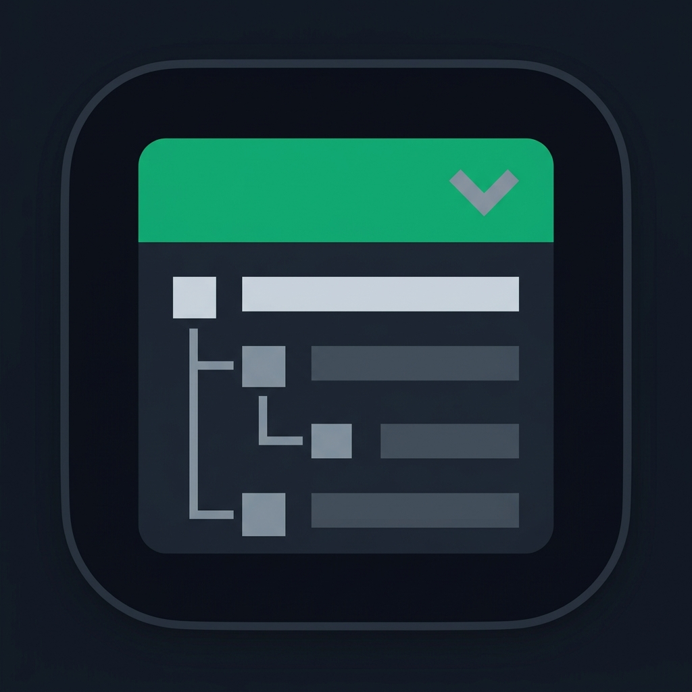
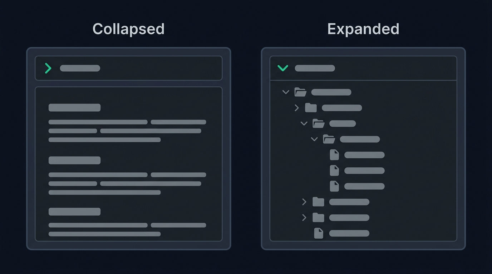
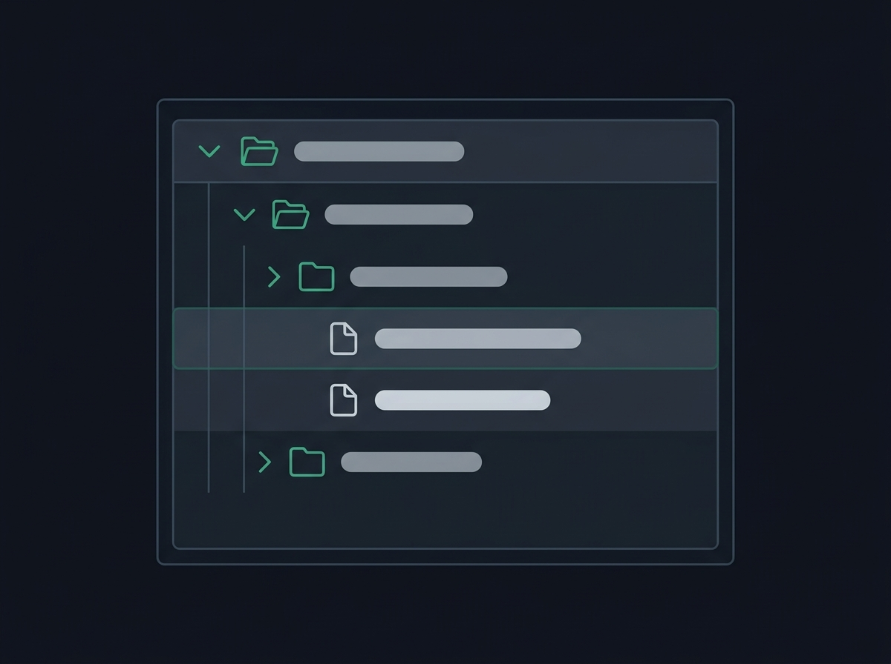
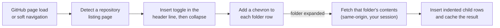

<div align="center">



<h1> GH-ListRollup</h1>

<p><strong>Collapse GitHub's file listing to a single line, and expand folders in place as a nested tree.</strong></p>

<p>
  <a href="https://github.com/doublegate/GH-ListRollup/actions/workflows/ci.yml"></a>
  <a href="#license"></a>
  
  
  
  
</p>

<p>
  <a href="#features">Features</a> |
  <a href="#how-it-looks">How it looks</a> |
  <a href="#installation">Installation</a> |
  <a href="#how-it-works">How it works</a> |
  <a href="#privacy">Privacy</a> |
  <a href="#roadmap">Roadmap</a> |
  <a href="#development">Development</a>
</p>

</div>

---

## Why

GitHub's repository page puts the full folder and file table above the README. On a large project
that table can be a hundred rows, and the README you came to read sits a screen or two below it.
Browsing into a folder means a page load, and browsing back out means another.

GH-ListRollup changes two things:

- **The listing collapses to one line.** On every repository listing page, the file table starts
  collapsed to its header line, so the README is right there. One click brings the listing back.
- **Folders expand in place.** Each folder gets an arrow and opens inline, as a nested tree, so you
  can look three levels deep without leaving the page.

> [!NOTE]
> **Project status: alpha.** The whole-listing collapse (Level 1) works in Chrome and Firefox. It was
> verified live on github.com, across soft navigations, re-renders and themes, with no flash of the
> full listing. The inline nested folder tree (Level 2) is next, in Phase 2. There is no store
> release yet; install from source. See the [roadmap](#roadmap). Known non-blocking edge cases are
> tracked in [GitHub issues](https://github.com/doublegate/GH-ListRollup/issues).

## Features

|       | Feature                                              | Details                                                                                                                                                                                                                                             |
| ----- | ---------------------------------------------------- | --------------------------------------------------------------------------------------------------------------------------------------------------------------------------------------------------------------------------------------------------- |
| **1** | **Whole-listing collapse**                           | The listing starts collapsed to its header line, the latest-commit bar. This applies to the repository root, `/tree/<branch>`, and every folder page. A chevron on that line expands and collapses it.                                              |
| **2** | **Inline nested tree** _(Phase 2)_                   | Every folder row gets its own chevron. Folders start collapsed and expand in place, recursively, loading their contents on demand. Clicking a folder's name still opens it normally.                                                                |
|       | **Follows GitHub's navigation**                      | GitHub switches pages without full reloads. GH-ListRollup detects those navigations and re-applies itself exactly once.                                                                                                                             |
|       | **Native look**                                      | Colors come from GitHub's own Primer design tokens, so light, dark, dimmed and high-contrast themes all work.                                                                                                                                       |
|       | **Keyboard and screen readers**                      | Real buttons with `aria-expanded`; Enter and Space toggle; Right and Left arrows expand and collapse.                                                                                                                                               |
|       | **Private repositories without a token** _(Phase 2)_ | Folder contents are loaded the way GitHub's own page loads them, using your existing GitHub session. There is no token to create and no API quota to use up.                                                                                        |
|       | **No flicker**                                       | The listing is hidden from the first paint, and again from the start of an in-page navigation, until its toggle is in place. A per-frame probe confirms that the full listing never flashes.                                                        |
|       | **Fails safe**                                       | If GitHub's markup changes in a way the extension cannot recognise, it leaves the page alone. It never hides a listing it cannot restore: if the header line goes missing, the extension updates or the page misbehaves, the files are shown again. |
|       | **Small and private**                                | One content script of a few kilobytes. It runs only on `github.com` and collects nothing.                                                                                                                                                           |

## How it looks

<div align="center">
  
  <p><em>Concept illustration. Left: the listing collapsed to its header line. Right: the listing expanded, with folders opened in place.</em></p>
</div>

The same behaviour, in text:

```text
[>] octocat  Fix build script  a1b2c3d  2 days ago  128 Commits     <- collapsed (default)

README.md
...

[v] octocat  Fix build script  a1b2c3d  2 days ago  128 Commits     <- expanded
    > .github
    v src
        > components
        v lib
            api.ts
            util.ts
      package.json
      README.md
```

<div align="center">
  
</div>

## Installation

> [!IMPORTANT]
> Store listings for the Chrome Web Store and Firefox Add-ons are planned for v1.0 (Phase 5). Until
> then, build from source.

### From source

Requirements: Node.js 22.18 or later (the project uses 26 LTS), with corepack enabled.

```sh
git clone https://github.com/doublegate/GH-ListRollup.git
cd GH-ListRollup
corepack enable
pnpm install
pnpm build            # Chrome build in .output/chrome-mv3
pnpm build:firefox    # Firefox build in .output/firefox-mv3
```

**Chrome, Edge, Brave and other Chromium browsers**

1. Open `chrome://extensions` (or `edge://extensions`).
2. Turn on **Developer mode**.
3. Click **Load unpacked** and choose `.output/chrome-mv3`.

**Firefox**

1. Open `about:debugging#/runtime/this-firefox`.
2. Click **Load Temporary Add-on...** and choose `.output/firefox-mv3/manifest.json`.

Firefox removes temporary add-ons when it restarts. A permanently installable signed build will be
published on AMO.

### Compatibility

| Browser                       | Minimum version | Manifest             | Status                       |
| ----------------------------- | --------------- | -------------------- | ---------------------------- |
| Chrome, Chromium, Edge, Brave | 121             | MV3 (service worker) | Builds                       |
| Firefox desktop               | 142             | MV3 (event page)     | Builds; `web-ext lint` clean |
| Firefox for Android           | --              | --                   | Not planned for v1           |
| GitHub Enterprise Server      | --              | --                   | Not planned for v1           |

## How it works



- **One content script** runs on `github.com`, built with [WXT](https://wxt.dev) for Chrome and
  Firefox from a single TypeScript codebase.
- **It adds to GitHub's DOM and never rewrites it.** The extension inserts its own marked controls
  and rows beside GitHub's, so GitHub's React app stays consistent. Every change is idempotent and is
  re-applied after GitHub re-renders.
- **Selectors are ranked, with fallbacks,** and kept in a single module. Hashed CSS class names,
  which change with every GitHub deploy, are never used.
- **Folder contents come from the JSON route GitHub's own code view uses**
  (`/<owner>/<repo>/tree/<ref>/<path>` with `Accept: application/json`). That request is same-origin,
  so it carries your existing session. A documented REST API fallback is planned for the case where
  GitHub changes that route.
- **Filenames never become HTML.** Every node is built with `createElement` and `textContent`, and
  lint enforces it.

Full details: [`docs/architecture.md`](docs/architecture.md),
[`docs/dom-integration.md`](docs/dom-integration.md) and
[`docs/data-fetching.md`](docs/data-fetching.md). The research behind these choices, with sources,
is in [`ref-docs/research-report.md`](ref-docs/research-report.md).

## Privacy

GH-ListRollup **collects no data**.

- It has no analytics, telemetry or remote code.
- It contacts nothing but GitHub, and only to load a folder you chose to expand.
- Permissions: `storage` (your display preferences) and access to `https://github.com/*`.

See [PRIVACY.md](PRIVACY.md) and [`docs/security-privacy.md`](docs/security-privacy.md).

## Roadmap

| Phase                      | Goal                                                                                                      | Status   |
| -------------------------- | --------------------------------------------------------------------------------------------------------- | -------- |
| 0. Foundation              | Skeleton builds for both browsers; CI; test fixtures                                                      | Complete |
| 1. Listing collapse        | Level 1 on every listing page; survives soft navigation                                                   | Complete |
| 2. Inline tree             | Lazy nested folder expansion; cache; keyboard and ARIA                                                    | Next     |
| 3. Settings and resilience | Options page; selector fallbacks; optional REST fallback                                                  | Planned  |
| 4. Testing and hardening   | Playwright end-to-end tests; Firefox smoke suite; weekly live probe; performance budgets; security review | Planned  |
| 5. Release                 | Chrome Web Store and Firefox Add-ons; v1.0.0                                                              | Planned  |

Sprint and ticket detail: [`to-dos/ROADMAP.md`](to-dos/ROADMAP.md). Current state:
[`PROJECT-STATUS.md`](PROJECT-STATUS.md).

## Development

```sh
pnpm dev              # Chrome, with the extension loaded and live reload
pnpm dev:firefox      # Firefox
pnpm test             # unit tests (Vitest)
pnpm check            # every gate: format, lint, typecheck, tests with coverage, both builds, web-ext lint
```

| Path                              | Contents                                                                       |
| --------------------------------- | ------------------------------------------------------------------------------ |
| `src/entrypoints/`                | The content script, its stylesheet, and the background script                  |
| `src/features/`                   | The collapse controller and its lifecycle (pre-hide, watchdogs, observers)     |
| `src/github/`                     | Selectors, page model, header line, probe, navigation (fixture-tested)         |
| `src/ui/`                         | The toggle button                                                              |
| `tests/`                          | Vitest unit tests, sanitized GitHub fixtures, and manual live-check scripts    |
| [`docs/`](docs/)                  | Implementation specs and decision records ([ADRs](docs/adr/))                  |
| [`ref-docs/`](ref-docs/README.md) | Research: GitHub internals, Chrome and Firefox MV3, stores, tooling, prior art |
| [`to-dos/`](to-dos/ROADMAP.md)    | Phase, sprint and ticket plan                                                  |

Contributions are welcome. Please read [CONTRIBUTING.md](CONTRIBUTING.md) first; behaviour is
specified in `docs/`, and pull requests update the matching spec.

## FAQ

<details>
<summary><strong>Will this break when GitHub changes its pages?</strong></summary>

<br>GitHub's markup is not a public API, so some changes will need an update. The extension is built
to fail safe:

- if it cannot recognise the listing, it does nothing
- selectors have ranked fallbacks
- recorded fixtures are tested on every pull request
- a scheduled live probe will flag changes before users notice them

</details>

<details>
<summary><strong>Do I need a GitHub token?</strong></summary>

<br>No. Folder contents load through your normal GitHub session, the same way GitHub's own page
loads them, so private repositories you can see work too. An optional token may be offered later,
for the REST fallback only.

</details>

<details>
<summary><strong>Does it work alongside Refined GitHub or Octotree?</strong></summary>

<br>It is designed to. The extension only touches its own marked elements and scopes all of its CSS,
and compatibility with Refined GitHub is checked before each release.

</details>

<details>
<summary><strong>Does it change file pages, pull requests or GitHub's sidebar file tree?</strong></summary>

<br>No. It changes only the folder and file listing on repository code pages.

</details>

## Acknowledgments

- [Refined GitHub](https://github.com/refined-github/refined-github) (MIT) shipped the original
  "toggle files" idea. Its approach to surviving GitHub's DOM informed this design.
- [WXT](https://wxt.dev), for cross-browser builds.
- [Primer Octicons](https://github.com/primer/octicons) (MIT), for the chevron icon; its notice is
  in [`NOTICE`](NOTICE).
- Prior art studied during research: [Tako](https://github.com/brumm/tako),
  [Gitako](https://github.com/EnixCoda/Gitako) and Octotree.

GH-ListRollup is an independent project, not affiliated with or endorsed by GitHub, Inc. "GitHub"
is a trademark of GitHub, Inc.

## License

Licensed under either of

- Apache License, Version 2.0 ([LICENSE-APACHE](LICENSE-APACHE))
- MIT license ([LICENSE-MIT](LICENSE-MIT))

at your option.

Unless you explicitly state otherwise, any contribution intentionally submitted for inclusion in the
work by you, as defined in the Apache-2.0 license, shall be dual licensed as above, without any
additional terms or conditions.
