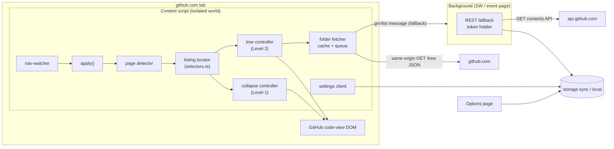

# Architecture

**Status:** Draft v0.1 (2026-11-15)
**Sources:** `ref-docs/research-report.md` §1-§5; related specs are linked per component.

## 1. Overview

GH-ListRollup is a single MV3 content script plus a small background script and an options page.
WXT builds them for Chrome and Firefox from one TypeScript codebase (`docs/adr/0001-wxt-typescript.md`).

## 2. Components

| Component           | Module                                         | Responsibility                                                                                                                                                                                                                                                                                  | Spec                             |
| ------------------- | ---------------------------------------------- | ----------------------------------------------------------------------------------------------------------------------------------------------------------------------------------------------------------------------------------------------------------------------------------------------- | -------------------------------- |
| Entry               | `src/entrypoints/content/index.ts`             | `defineContentScript` matching `https://github.com/*`, run at `document_start`. Sets the pending attribute, wires `nav-watcher`, and owns the `ctx` lifetime.                                                                                                                                   | `docs/dom-integration.md` §4     |
| nav-watcher         | `src/github/nav.ts`                            | Turns the page events into one debounced `apply()` call per frame. The events are `soft-nav:end`, `soft-nav:react-done`, `turbo:render`, `turbo:load`, `navigatesuccess`/`popstate` and `wxt:locationchange`, plus the first-listing observer. All listeners go through `ctx.addEventListener`. | `docs/dom-integration.md` §4     |
| Page detector       | `src/github/page.ts`                           | URL and DOM to a `ListingPage` (owner, repo, ref, path, layout), or `null`. Pure function of `(url, document)`.                                                                                                                                                                                 | `docs/dom-integration.md` §3     |
| Selectors           | `src/github/selectors.ts`                      | Every selector, ranked, plus `probe()`. The only place selector strings may appear.                                                                                                                                                                                                             | `docs/dom-integration.md` §2, §6 |
| Collapse controller | `src/features/collapse.ts`                     | Level 1: inserts the toggle into the header line, owns collapsed and expanded state, per-repo memory.                                                                                                                                                                                           | `docs/ui-behavior.md` §2         |
| Tree controller     | `src/features/tree.ts`                         | Level 2: folder arrows in both name cells, inline rows, an expansion-state map keyed by path, keyboard handling, error rows.                                                                                                                                                                    | `docs/ui-behavior.md` §3         |
| DOM builders        | `src/ui/*.ts`                                  | Builds the toggle, arrows, rows and icons with `createElement` and `textContent` only.                                                                                                                                                                                                          | `docs/security-privacy.md` §2    |
| Folder fetcher      | `src/data/fetcher.ts`, `src/data/tree-json.ts` | `FolderSource` implementation: cache, de-duplication, a 4-request concurrency queue, abort, defensive parsing, fallback selection.                                                                                                                                                              | `docs/data-fetching.md`          |
| Settings            | `src/settings.ts`                              | `storage.defineItem` declarations, validation, watchers.                                                                                                                                                                                                                                        | `docs/settings.md`               |
| Background          | `src/entrypoints/background.ts`                | Handles `gnr/list` messages for the REST fallback, holds the token, tracks the rate limit. Stateless between wake-ups apart from storage.                                                                                                                                                       | `docs/data-fetching.md` §4       |
| Options page        | `src/entrypoints/options/`                     | Settings UI, token test, permission grant button.                                                                                                                                                                                                                                               | `docs/settings.md` §3            |
| Styles              | `src/entrypoints/content/style.css`            | Injected through the manifest; Primer variables only.                                                                                                                                                                                                                                           | `docs/ui-behavior.md` §4         |

The dependency direction is strictly downward:

1. entry and nav
2. features
3. `ui` and `data`
4. `github`
5. settings and platform

Nothing in `data` or `github` imports from `features`. `github/*` and `data/tree-json.ts` are pure, so
they can be unit-tested against fixtures with no browser.

## 3. Key flows

### 3.1 Page load (listing present in the first HTML)

1. `document_start`: on a URL with a listing shape, the entry sets `html[data-gnr-pending]`, so CSS
   hides rows, starts the 4-second watchdog and starts the settings read. This pre-hide is the one
   bounded exception to the rule that the listing is never hidden without a toggle
   (`docs/dom-integration.md` §4).
2. The first-listing observer sees `[data-testid="directory-content"]` and calls `apply()`.
3. `apply()`: the detector returns a `ListingPage`. The collapse controller inserts the toggle and
   applies the stored or default state. The tree controller decorates folder rows. Then
   `data-gnr-pending` is removed.
4. Any `apply()` exit that does not install the toggle removes `data-gnr-pending` at once: not a
   listing page, the confidence gate failed, a needed selector missed, or an exception. The watchdog
   covers everything else.

### 3.2 Soft navigation

1. GitHub fires `soft-nav:end` and later `soft-nav:react-done`. Each schedules `apply()`.
2. If the navigation reached a **different listing** (`location.pathname` changed, which covers a
   new repo, ref or folder path), both controllers reset. Level 1 returns to the default state, or
   the remembered per-repo state when `listing.rememberPerRepo` is on. Level 2 starts with every
   folder collapsed (`docs/ui-behavior.md` §2.1, §3.1). The fetcher cache is cleared only when the
   repo or ref changed, since its entries stay valid across folders of the same ref.
3. If the `apply()` comes from a React re-render of the **same listing**, the existing state is
   re-applied, so the toggle and expanded folders survive the re-render.

### 3.3 Expanding a folder

1. Arrow click: the tree controller marks the row busy and calls `fetcher.list(key, signal)`.
2. The fetcher returns a cached result, or joins an in-flight request, or queues a same-origin fetch.
3. The response is parsed into a `FolderListing`. Inline rows are built and inserted after the folder
   row, with indentation from depth.
4. On `SchemaError`, the fetcher sends `gnr/list` to the background, which may use the REST API.

## 4. State

| State                          | Owner                                    | Lifetime                                                               |
| ------------------------------ | ---------------------------------------- | ---------------------------------------------------------------------- |
| Collapsed or expanded per page | Collapse controller                      | Page view. Persisted per repo only if `listing.rememberPerRepo` is on. |
| Expanded paths and inline rows | Tree controller (`Map<path, NodeState>`) | Page view; reset on navigation to a different listing                  |
| Folder listings                | Fetcher cache                            | Tab, in memory; reset when the repo or ref changes                     |
| Settings                       | `storage.sync` / `storage.local`         | Persistent                                                             |
| Token, rate-limit reset time   | Background (`storage.local`)             | Persistent; never sent to content scripts                              |

## 5. Non-functional targets

| Target                                             | Budget                                        | How it is measured                                   |
| -------------------------------------------------- | --------------------------------------------- | ---------------------------------------------------- |
| Added time to first apply after the listing exists | < 5 ms (p95) on a 100-row listing             | `performance.mark` in debug builds; Playwright trace |
| Content script bundle                              | < 30 KB minified, excluding CSS               | `wxt build` output check in CI                       |
| Expansion latency (cached)                         | < 16 ms, one frame                            | Playwright test                                      |
| Network                                            | 1 request per first expansion; 0 on re-expand | Fetcher unit tests                                   |
| Memory                                             | Cache ≤ 200 folders per tab (LRU)             | Unit test                                            |

Details are in `docs/testing-strategy.md` §6.
